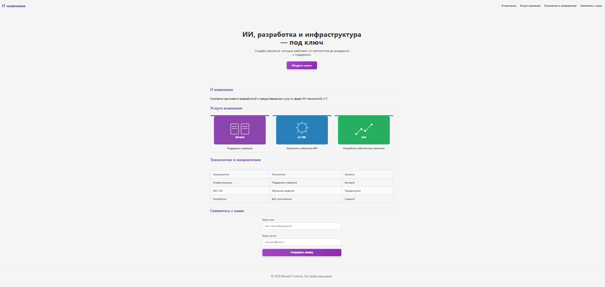
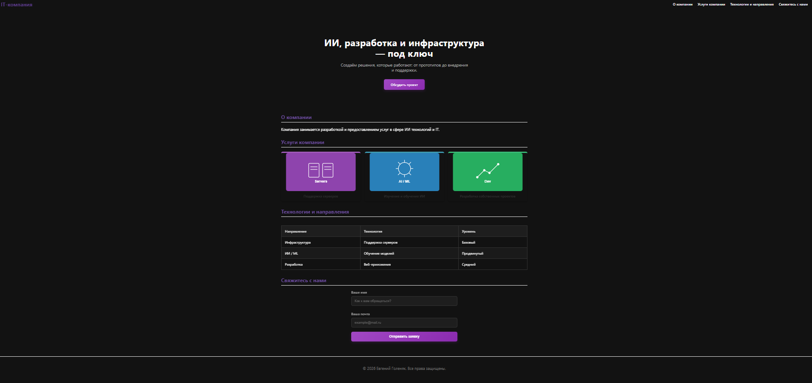

# IT Landing Page

Современный лендинг для IT‑компании: адаптивная вёрстка, авто‑тёмная тема, анимации и чистый код.

## Посмотреть демо
👉 [Открыть сайт](https://gekafirst.github.io/my-website/)

## Скриншоты

| Светлая тема | Тёмная тема |
| --- | --- |
|  |  |

## О проекте

Это учебный лендинг для IT‑студии/аутсорса. Проект создан в рамках обучения фронтенду (HTML/CSS, адаптивность, семантика, работа с Git).

**Основные возможности:**
- Адаптивная вёрстка (Mobile First): корректно отображается на мобильных, планшетах и десктопах.
- Авто‑переключение на тёмную тему через `prefers-color-scheme`.
- Плавная прокрутка по якорям (`html { scroll-behavior: smooth }`).
- CSS‑анимации появления блоков (`fadeInUp`, `fadeInScale`).
- Векторная иконка (SVG) без потери качества.
- Чистый, читаемый код с использованием CSS‑переменных для лёгкой смены палитры.

### Реализованные эффекты

- **Каскадное появление карточек** через `@keyframes fadeInUp`: элементы появляются по очереди с задержкой (`animation-delay`), создавая эффект «волны».
- **Ховер‑эффект карточек**: при наведении карточка плавно поднимается вверх и слегка увеличивается — реализовано через `transform: translateY(-12px) scale(1.03)`.
- **Плавность переходов**: все анимации работают через `transition`, чтобы движение было мягким, без рывков.

### Адаптация под устройства

- **Десктоп**: полная анимация — подъём + увеличение.
- **Мобильные устройства (до 768px)**: в медиа‑запросе убрано увеличение (`scale`) — остаётся только лёгкий подъём. Это предотвращает «выпирание» элементов и горизонтальный скролл на узких экранах.

### Технические детали

- Анимации реализованы на чистом CSS без JavaScript.
- Для управления параметрами анимации используются CSS‑переменные (например, `--anim-speed`, `--transition`).
- Приоритеты стилей настроены так, чтобы мобильная версия корректно переопределяла десктопные эффекты.

## Особенности реализации

- Цветовая схема вынесена в `:root` и переопределяется в `@media (prefers-color-scheme: dark)`.
- Анимация карточек при наведении: подъём и масштабирование через transform с плавностью на transition.
- Реализована каскадная анимация появления 3 карточек услуг через @keyframes fadeInUp и animation-delay (0.05s, 0.25s, 0.45s).
- Добавлен эффект всплытия и увеличения при наведении (transform: translateY + scale).
- Таблицы адаптируются под мобильные устройства (превращаются в карточки).
- Формы имеют базовые состояния `:focus`, `:valid`, `:invalid`.
- Адаптивные отступы и зазоры реализованы через `calc()`: например, `gap: calc(1rem + 1vw)` делает сетку более гибкой на разных экранах.
- Радиусы скруглений и внутренние отступы зависят от базовой переменной `--radius`: `border-radius: calc(var(--radius) * 1.2)`, что позволяет менять стиль всей страницы изменением одной переменной.

## Технологии и стек

- HTML5: семантическая разметка, доступность.
- CSS3: Flexbox, Grid, переменные, медиа‑запросы, анимации.
- SVG: векторные иконки.
- Git: контроль версий, коммиты, история изменений.
- SCSS: стили собраны с использованием системы модулей (@use). Каждый файл самодостаточен и явно подключает зависимости (variables, mixins).

## Чему научился

- Реализовал авто‑тему без JS: управление цветами через CSS‑переменные и `prefers-color-scheme`.
- Научился использовать `calc()` для создания адаптивных отступов и зазоров, а также для вычислений на базе CSS‑переменных.
- Потренировался в поддержании чистого кода и семантической разметки.
- Реализовал каскадную анимацию появления элементов с помощью `@keyframes` и `animation-delay`.
- Научился комбинировать `transform` и `transition` для создания плавных ховер‑эффектов.
- Понял, как браузеры эмулируют `:hover` на тач‑устройствах, и адаптировал анимации: на мобильных убрал `scale`, чтобы не ломать верстку.
- Научился применять псевдоэлементы (::before, ::after) и псевдоклассы (:hover, :focus, :valid, :invalid, :nth-child) для создания интерактивности и декораций без JS.